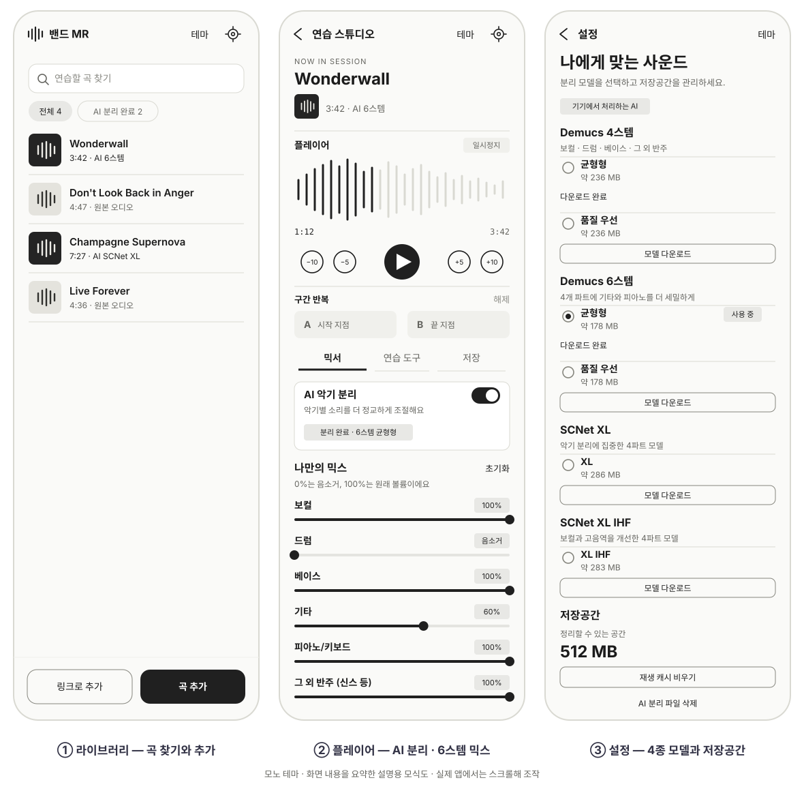

# 밴드 MR (Band MR)

보컬·드럼·베이스·기타·피아노·그 외 소리를 줄여 합주용 반주를 만드는 Android 앱입니다.

[APK 다운로드](https://github.com/hyuunnn/band-mr/releases/latest) · [그림으로 보기](docs/index.html) · [라이선스 고지](THIRD_PARTY_NOTICES.md)

## 사용법

1. 음악 파일이나 유튜브 링크로 곡을 추가합니다.
2. 곡을 열어 AI OFF로 연습합니다. AI 분리를 사용하려면 설정에서 모델을 다운로드하고 선택한 뒤, 플레이어의 **믹서 → AI 악기 분리**를 켜고 **이 곡 분리하기**를 누릅니다.
3. 믹서에서 소리를 조절하고, **연습 도구**에서 키·배속을 바꿉니다. 파형·점프 버튼·A-B 구간 반복은 플레이어에서 조작합니다.
4. **저장** 탭에서 **현재 믹스 저장** 또는 분리 완료 후 **악기별 파일 저장**을 선택합니다.



모노 테마 기준의 설명용 모식도입니다. 긴 화면은 내용을 요약했으며, 실제 앱에서는 스크롤해 조작합니다.

## 주요 기능

| 기능 | 범위 |
|---|---|
| 악기 조절 | AI OFF: 체크 제거·보컬 강도 조절. AI ON: 4/6스템별 볼륨 0~100%(피아노·그 외는 AI 전용) |
| 키·배속 | ±12반음, 0.25×~2×. 곡마다 저장 |
| 재생 | 파형 시크, ±5/±10초 점프, A-B 반복(최소 0.5초) |
| 백그라운드 | 알림·잠금화면·블루투스 조작. 전화·이어폰 분리 시 일시정지 |
| 저장 | 믹스·스템 WAV 내보내기. 믹스에는 볼륨·키만 적용하며 배속·A-B는 제외 |
| 관리 | 테마 10종, 재생 캐시·분리 결과 정리 |

## AI 모델

설정에서 원하는 모델을 다운로드하고 선택합니다. 분리는 폰에서 처리하고, 완료된 결과는 재사용합니다.
AI OFF는 모델 없이 동작하는 근사 처리입니다.

| 모델 | 스템 | 용량 |
|---|---|---|
| Demucs htdemucs | 보컬·드럼·베이스·그 외 | 약 236MB |
| Demucs htdemucs_6s | 위 4종 + 기타·피아노 | 약 178MB |
| SCNet XL | 보컬·드럼·베이스·그 외 | 약 286MB |
| SCNet XL IHF | 보컬·드럼·베이스·그 외 | 약 283MB |

Demucs는 균형형·품질 우선을 제공합니다. 품질 우선은 시간과 메모리가 더 필요합니다.
SCNet XL은 Demucs보다 느리고, XL IHF는 XL보다 시간이 더 걸립니다. SCNet은 메모리 4GB 이상인 기기를 권장합니다.
분리 시간은 곡·모델·기기에 따라 달라집니다.
모델은 [model-v3](https://github.com/hyuunnn/band-mr/releases/tag/model-v3)에서 내려받으며 SHA-256을 검증합니다.

## 동작 안내

- 첫 재생이나 재생 캐시를 비운 뒤에는 원본 오디오 준비에 시간이 걸릴 수 있습니다. 플레이어에 준비 상태를 표시하며, 실패하면 재생 버튼으로 다시 시도합니다.
- AI ON도 분리 완료 전에는 원본 오디오로 재생합니다. 모델 파일 확인 중에는 분리 버튼이 비활성화되며, 기존 재생은 유지됩니다.
- 모델을 바꿔도 기존 곡의 분리 결과는 유지됩니다. 다른 모델로 교체하려면 플레이어에서 **다시 분리**를 실행합니다.
- 유튜브 입력창의 '닫기'는 작업을 계속하고, '중단'은 확인 팝업을 거쳐 취소합니다.
- 중단 후 다시 추가하면 이전 작업 정리를 기다리며, 대기 중에도 진행 표시와 중단 버튼이 나옵니다.
- 같은 영상을 다시 추가하면 키·배속을 따로 설정할 수 있는 별도 곡으로 등록합니다. 내려받은 원본은 재사용하고, 원본이 없으면 다시 받습니다.
- 유튜브 곡 추가의 캐시 준비가 실패하거나 중단되면 이번에 새로 등록한 곡은 목록에서 제거합니다. 내려받은 원본은 같은 실행 안의 재시도에 재사용하며, 어떤 곡도 참조하지 않으면 다음 앱 실행 때 정리합니다.
- 믹스·스템 저장은 플레이어에서 나가도 계속됩니다. 같은 곡을 다시 열면 진행 상태와 결과를 확인할 수 있습니다.
- 믹스 저장 실패·중단 시 빈 파일이나 잘린 WAV를 삭제합니다. 저장 위치에서 삭제를 허용하지 않으면 파일 정리 실패를 표시합니다.
- 유튜브·모델 다운로드는 완료까지 앱을 열어 두는 것을 권장합니다. 백그라운드에서는 중단될 수 있습니다.
- 재분리 취소는 결과 교체 확정 전까지 이전 결과를 보존합니다.
- 설정의 **재생 캐시 비우기**는 재생을 멈추고 캐시를 정리합니다. **AI 분리 파일 삭제**는 확인 후 전체 분리 결과를 지우며, 이후 다시 분리해야 합니다. 곡 목록과 원본은 보존합니다.
- 알림을 지우거나 최근 앱에서 앱을 치우면 재생이 종료됩니다. 홈으로 나가면 재생을 유지합니다.
- AI OFF·키 변경은 음질에 영향을 줄 수 있고, 일부 기기는 낮은 배속을 지원하지 않습니다.

## 개발

JDK 17, Android SDK 37 필요. Android 13 이상 지원. `JAVA_HOME`·`ANDROID_HOME` 설정은 [개발 규칙의 빌드·검증](AGENTS.md#빌드검증)을 참고합니다.

```bash
./gradlew :app:testDebugUnitTest
./gradlew :app:assembleDebug
./gradlew :app:assembleRelease
```

배포 APK는 `app/build/outputs/apk/release/app-release.apk`입니다.
릴리즈 서명은 커밋하지 않는 `keystore.properties`로 설정합니다.
동일 서명의 APK는 `adb install -r`로 데이터를 유지하며 업데이트합니다.
릴리즈 태그는 APK를 빌드한 커밋을 가리켜야 합니다.

[개발 규칙·코드 지도](AGENTS.md) · [모델 변환 절차](tools/README.md)
